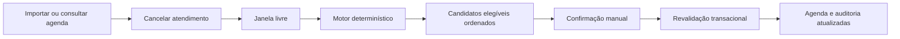
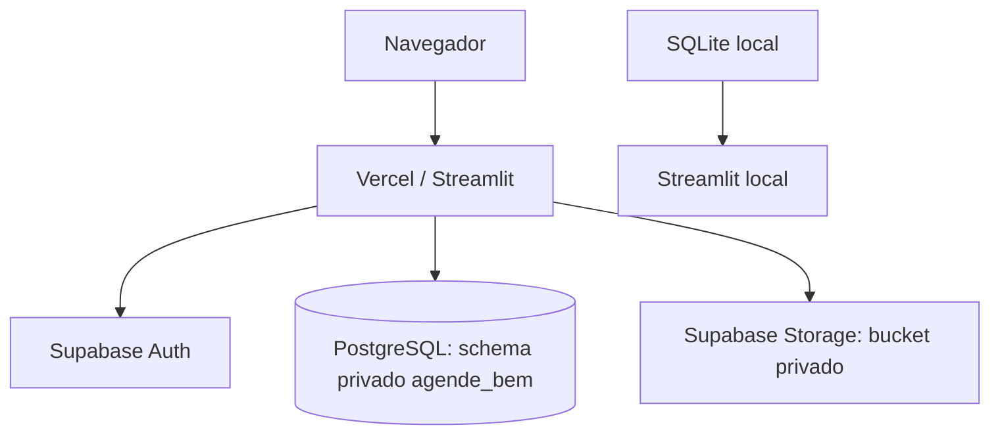

# Agende Bem — Agenda Inteligente

Agende Bem é uma aplicação para a recepção de uma clínica reorganizar a agenda após cancelamentos. Ela identifica horários liberados, avalia pacientes da lista de espera por regras objetivas e permite que a recepção confirme manualmente um encaixe seguro.

O projeto foi desenvolvido para o **OpenAI Hackathon — Saúde, Desafio 2: Agenda inteligente para uma clínica**. Ele atende o recorte do desafio: uma clínica, um dia de atendimento e até três profissionais. Recursos de autenticação, arquivos e modelos fazem parte da evolução V3 do MVP, não do escopo mínimo original.

> Demonstração protegida: [agende-bem-demo.vercel.app](https://agende-bem-demo.vercel.app)

## Problema e proposta

Um cancelamento abre uma janela que a recepção precisa preencher sem criar conflitos de agenda nem perder tempo comparando disponibilidade, duração e profissional manualmente. O Agende Bem transforma essa janela em uma lista explicável de alternativas, preservando a decisão final humana.

O motor de sugestões é **determinístico e baseado em regras**; ele não é apresentado como IA generativa.

## Funcionalidades

| MVP do desafio | Evolução V3 |
| --- | --- |
| Importação e exportação de agenda CSV | Login com Supabase Auth e papéis operacionais |
| Agenda por profissional, tabela e linha do tempo | Biblioteca privada de arquivos CSV/PDF |
| Lista de espera com disponibilidade e duração | Catálogo versionado de cinco modelos operacionais |
| Cancelamento com confirmação | Pacientes preparados para identificação única |
| Sugestões elegíveis e inelegíveis explicadas | Histórico de auditoria, indicadores e modo de apresentação |
| Confirmação transacional de encaixe | Dashboard e visão de aproveitamento operacional |

## Como funciona



Para cada entrada ativa na lista de espera, o motor verifica: profissional aceito, duração que cabe na vaga, janela de disponibilidade, mesmo dia de agenda e ausência de conflito do profissional ou do paciente. Os elegíveis são ordenados por maior tempo de espera, menor sobra de minutos e ordem de cadastro. O serviço revalida todos os critérios dentro da transação antes de gravar.

Leia os detalhes em [docs/BUSINESS_RULES.md](docs/BUSINESS_RULES.md).

## Stack e arquitetura

- Python 3.11+ (imagem de produção Python 3.14.4)
- Streamlit 1.66.1 e CSS próprio para a interface
- SQLite para desenvolvimento local; PostgreSQL/Supabase para operação remota
- Supabase Auth e Storage privado para a evolução V3
- Vercel Container para o deployment protegido
- Pandas 3.1.0 e Pytest 9.1.1 para dados e testes



A documentação de arquitetura, banco, segurança e deploy está no [índice técnico](docs/README.md).

## Telas e evidências visuais

As telas cobertas pela V3 são Login, Dashboard, Agenda, Lista de espera, Central de encaixes, Histórico, Arquivos, Modelos e Usuários e permissões. As capturas finais, quando produzidas em navegador pessoal autorizado com dados sintéticos, devem ser armazenadas em [`docs/assets/`](docs/assets/) e catalogadas em [`docs/screenshots/`](docs/screenshots/). Nenhuma imagem ilustrativa ou dado de paciente real é usado como evidência.

## Estrutura do repositório

```text
.
├── web-demo/                 # Aplicação Streamlit, domínio, migrations e testes
│   ├── app.py                # Telas e navegação
│   ├── scheduler.py          # Motor puro de sugestões
│   ├── services.py           # Casos de uso e transações
│   ├── migrations/           # SQLite e PostgreSQL
│   ├── tests/                # Testes automatizados
│   └── docs/                 # Registros técnicos históricos da V3
├── docs/                     # Documentação pública e de entrega
└── projeto final entrega/    # Material acadêmico original preservado
```

## Executar localmente

```powershell
git clone https://github.com/ThiagoAlves-zc/Agendamento--Agende-bem.git
cd Agendamento--Agende-bem\web-demo
python -m venv .venv
.\.venv\Scripts\Activate.ps1
pip install -r requirements-dev.txt
streamlit run app.py
```

Abra `http://localhost:8501`. Sem `DATABASE_URL`, a aplicação usa SQLite em `web-demo/data/agende_bem.db` e inicia um cenário sintético de demonstração. Para operar com Supabase, copie `.env.example` para um arquivo local ignorado pelo Git e siga [docs/DEPLOYMENT.md](docs/DEPLOYMENT.md). Nunca versione senhas, tokens, URLs administrativas ou bancos locais.

## Testes e validações

```powershell
cd web-demo
.\.venv\Scripts\python.exe -m pytest -q
```

A última execução local registrada nesta entrega teve **63 aprovados e 40 ignorados**. Os ignorados requerem um PostgreSQL descartável configurado por `TEST_PG_ADMIN_URL`; eles não devem ser executados contra o Supabase hospedado. Veja escopo, comandos e limitações em [docs/TESTING.md](docs/TESTING.md).

## Segurança e privacidade

- O projeto usa dados sintéticos; não solicita CPF, prontuário ou diagnóstico.
- O papel operacional é resolvido no servidor a partir de `app_users`, não de metadados editáveis do usuário.
- Arquivos permitidos são CSV/PDF operacionais, com limite de 5 MB, validação de MIME/assinatura e hash SHA-256.
- O schema `agende_bem` é privado e não deve ser exposto pela Data API.

Isso não constitui certificação de conformidade clínica, LGPD ou segurança para dados reais. Consulte [docs/SECURITY.md](docs/SECURITY.md).

## Limitações e roadmap

O Streamlit em ambiente serverless pode perder estado efêmero após reconexões WebSocket; dados críticos continuam no banco e encaixes são revalidados. Para uso contínuo, recomenda-se hospedagem com processo persistente e afinidade de sessão. Os próximos passos estão em [docs/ROADMAP.md](docs/ROADMAP.md).

## Participantes e créditos

Autoria original e histórico acadêmico: **Thiago Alves**. Evolução técnica e V3 registrada no histórico Git por **Vitor Yoshii**. Os créditos são derivados do histórico do repositório e devem ser preservados em qualquer fork ou publicação.

Não há licença explícita versionada neste repositório; portanto, nenhuma licença é presumida.
