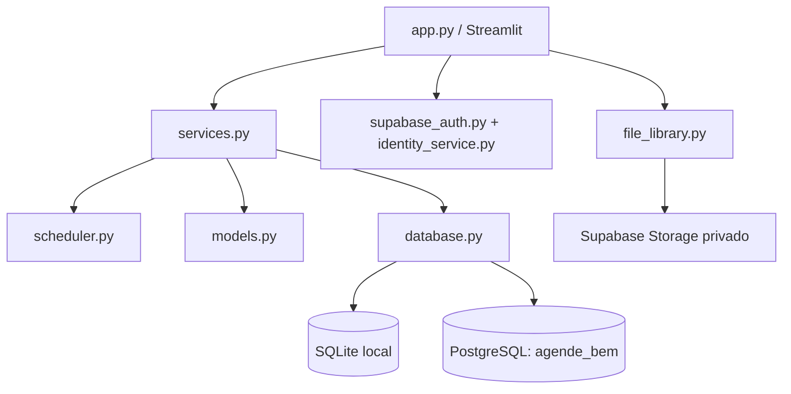

# Arquitetura

## Visão geral

O Agende Bem é um monólito Python com interface Streamlit. O domínio de agenda é separado da interface para manter o motor de encaixes testável e independente do banco.

## Camadas

| Camada | Responsabilidade |
| --- | --- |
| `app.py` | Renderização, formulários, diálogos, URL de navegação e feedback |
| `scheduler.py` | Cálculo puro de janelas, elegibilidade e ordenação |
| `services.py` | Cancelamento, confirmação, importação, projeções e auditoria |
| `models.py` | Entidades, datas, horários, sobreposição e validações |
| `database.py` | Conexões, placeholders, migrations e transações SQLite/PostgreSQL |
| `csv_handler.py` | Parse, limites, validação e exportação de CSV |
| `authorization.py` | Papéis e permissões server-side |
| `supabase_auth.py` | Login, refresh, logout e recuperação sem tokens na URL |
| `file_library.py` | Validação, metadados, Storage privado e hash |

## Estados e resiliência

Dados de agenda, lista, arquivos e auditoria ficam persistidos. Estado de tela fica em `st.session_state`, e a página atual também é refletida em `?pagina=` para reduzir perda de contexto numa reconexão. O estado efêmero de formulários ainda pode ser perdido em hospedagem serverless; operações de encaixe são revalidadas transacionalmente antes de gravar.

## Ambiente remoto

O container Streamlit roda na Vercel e acessa o schema privado `agende_bem` por uma role de aplicação com privilégios mínimos. Supabase Auth identifica o usuário; `app_users` define o papel operacional; Storage guarda somente o conteúdo dos arquivos. Consulte [SECURITY.md](SECURITY.md) e [DEPLOYMENT.md](DEPLOYMENT.md).
