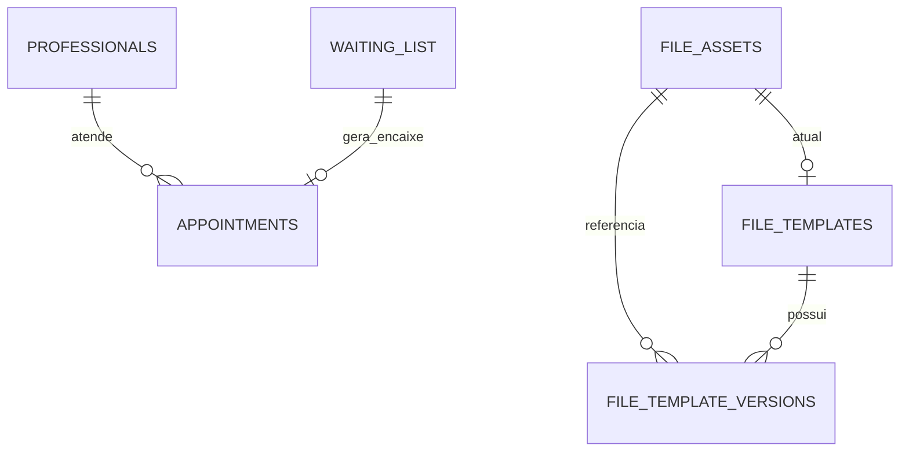

# Banco de dados

## Persistência

Em desenvolvimento, a aplicação usa SQLite. Em operação remota, usa PostgreSQL no schema privado `agende_bem`. O schema não deve ser adicionado aos schemas expostos pela Data API do Supabase.

## Entidades principais

| Tabela | Finalidade |
| --- | --- |
| `settings` | Configuração persistida da aplicação |
| `professionals` | Profissionais, expediente e situação |
| `appointments` | Agenda, cancelamentos e origem do encaixe |
| `waiting_list` | Solicitações de encaixe e disponibilidade |
| `audit_events` | Eventos operacionais sem credenciais ou conteúdo clínico |
| `patients` | Preparação para identidade de paciente; sem migração automática de nomes |
| `app_users` | Papel operacional vinculado ao `user_id` autenticado |
| `file_assets` | Metadados e hash de arquivos privados |
| `file_templates` | Modelos reutilizáveis e versão corrente |
| `file_template_versions` | Histórico de versões de modelos |

## Migrations PostgreSQL

| Arquivo | Conteúdo |
| --- | --- |
| `0001_schema.sql` | Schema, agenda, lista, auditoria e restrição de sobreposição |
| `0002_app_role.sql` | Role `agende_bem_app`, grants mínimos e RLS |
| `0003_reset_function.sql` | Reset exclusivo para cenário demonstrativo |
| `0004_v3_foundation.sql` | Pacientes, ativos de arquivo, modelos e versões |
| `0005_auth_rbac.sql` | `app_users` e papel operacional |

No PostgreSQL, a aplicação apenas verifica que migrations foram aplicadas. O operador usa `migrate.py` com conexão administrativa e Project Ref conferido. Não execute `0003_reset_function.sql` como restauração nem rode fixtures destrutivas em ambiente hospedado.

## Integridade e acesso

- `appointments_no_overlap` impede sobreposição de consultas confirmadas de um profissional.
- Chaves, `CHECK`s, índices e unicidade case-insensitive validam dados de pacientes e usuários.
- RLS está habilitado nas tabelas privadas e as políticas destinam-se ao papel da aplicação.
- `anon`, `authenticated` e `PUBLIC` não recebem acesso às tabelas privadas.
- Storage é acessado pela API oficial; não há manipulação direta do schema interno `storage`.

Veja [SECURITY.md](SECURITY.md) para limites de isolamento por usuário.
